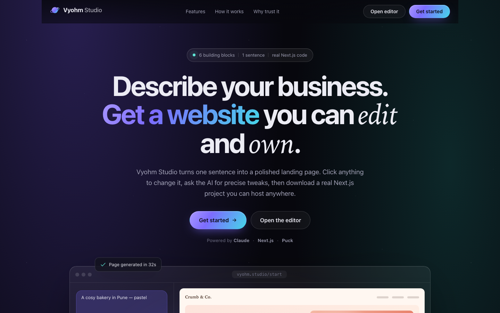
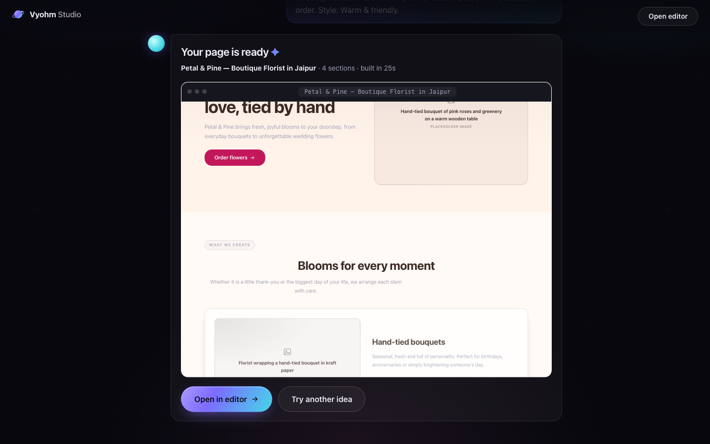
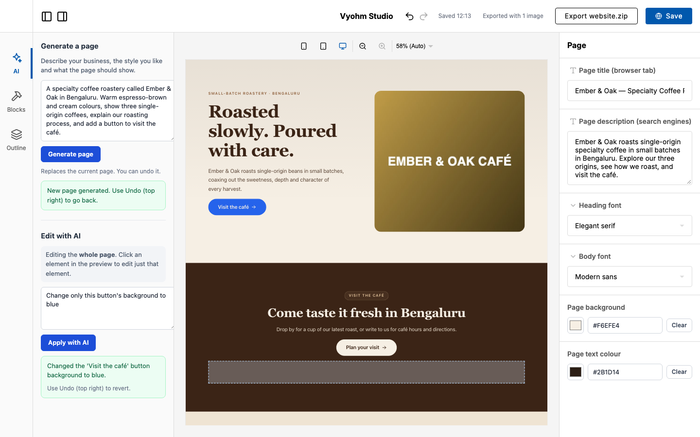
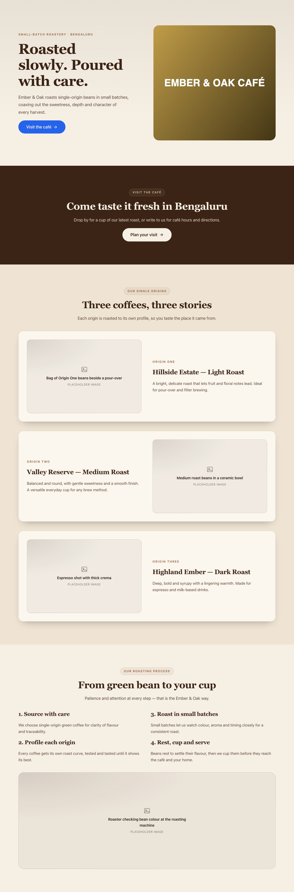

# Vyohm Studio

An AI website builder: describe a business, Claude generates a landing page, you edit it visually or with AI instructions, and you download a standalone Next.js project.

| Page | What it is |
|---|---|
| `/` | Vyohm Studio landing page: features, how it works, **Get started** |
| `/start` | *Create your landing page* chat: describe the business → build animation → live preview of the real page → **Open in editor** |
| `/editor` | The visual editor: click-to-edit, AI edits, mobile overrides, undo, autosave, export |

Built for the Vyohm AI FDE intern challenge (6-hour build).



| Get started chat | Building animation | Your real page, previewed |
|---|---|---|
|  |  |  |



| | |
|---|---|
| **Run it** | [Quick start](#quick-start) |
| **What works** | [Feature status](#feature-status) |
| **How it works** | [Architecture](#architecture) · [Decisions](#decisions-and-tradeoffs) · [Debugging examples](#debugging-examples) |
| **Evidence** | [docs/TESTING.md](docs/TESTING.md) · [evidence/](evidence/) · [evidence/website.zip](evidence/website.zip) |
| **AI use** | [docs/AI_USE.md](docs/AI_USE.md) |

---

## Quick start

**Requirements:** Node.js 22 (any version ≥ 20.9 works, see `.nvmrc`), npm 10, a Claude API key.

```bash
npm ci
cp .env.example .env.local      # then put your key in ANTHROPIC_API_KEY
npm run dev                     # http://localhost:3000 → Get started
```

| Variable | Required | Default | Purpose |
|---|---|---|---|
| `ANTHROPIC_API_KEY` | yes | – | Claude API key. Read only on the server; never sent to the browser or included in exports. |
| `ANTHROPIC_MODEL` | no | `claude-opus-5-5` | Model for generation and edits. |
| `ANTHROPIC_EFFORT` | no | `medium` (generate) / `low` (edit) | Thinking effort; lower is faster. |

Other scripts: `npm run build`, `npm run start`, `npm run lint`, `npm run verify-export -- <zip>`, `npm run test:browser` (see [docs/TESTING.md](docs/TESTING.md)).

## Demo walkthrough

1. **Generate.** On the landing page, click **Get started**. In the chat, describe the business (or pick an example and a style chip) and press **Enter**. A build animation shows the steps while Claude works (about 25–45 s, with Cancel). Then a live, auto-scrolling preview of the real page appears; click **Open in editor**. (Inside the editor, the **AI** tab can also generate a new page.)
2. **Edit text.** Click a heading and type directly on the canvas, or use the settings panel on the right (font size, weight, colour, alignment).
3. **Replace an image.** Select an image and click **Upload image** / **Replace image**. Size, fit, radius and alt text are in the same panel.
4. **Change the layout.** Drag elements between container columns and sections. Reorder sections by dragging, or in the **Outline** tab. The action bar on each selected element has duplicate and delete. Add new elements from the **Blocks** tab.
5. **AI edit.** Select a button. In **Edit with AI**, type *"Change only this button's background to blue"* and press **Apply with AI** (about 3 s). Choose **Whole page** for page-wide edits.
6. **Mobile.** Click the phone icon above the canvas. Under **Mobile overrides**, change e.g. the heading font size; desktop keeps its value. **Undo/Redo** are at the top right (also ⌘Z / ⇧⌘Z).
7. **Save and reload.** The page autosaves to the browser about 1 s after each change (or press **Save**). Reloading restores the page and uploaded images.
8. **Export.** Click **Export website.zip**, then check it like the evaluator would: `npm run verify-export -- ~/Downloads/website.zip`.

## Feature status

Status means: **Working** = verified by an automated test run (see [docs/TESTING.md](docs/TESTING.md)); **Partial** = works with a stated gap; **Untested** = implemented but not verified.

| Requirement | Status | Evidence / notes |
|---|---|---|
| **AI generation** from a fresh prompt via a real model call, relevant copy, requested theme, multi-section page | Working | Six briefs generated (clothing, bakery, yoga, architecture, coffee ×2), 20–42 s each; [full-flow.log](evidence/full-flow.log) |
| Generation loading and failure states | Working | Progress, timer and cancel; malformed result and API errors rejected with the page unchanged (`ai-failures`, server error cases in TESTING.md) |
| Six element types; container with 1 or 2 columns and nested elements | Working | [blocks.tsx](components/site/blocks.tsx), [puck-config.tsx](components/editor/puck-config.tsx) |
| Select and edit properties; direct canvas text editing | Working | `layout-and-inline` (typing on the canvas), `demo-sequence` (settings panel) |
| Button label, link and style; image upload/replace, size, fit, alt | Working | Fields in [puck-config.tsx](components/editor/puck-config.tsx); upload tested in `upload-persist` and `demo-sequence` |
| Add, duplicate, delete | Working | `layout-and-inline` (action bar duplicate/delete; insert) |
| Move between containers, reorder sections | Working | `drag-and-drop`: a **real mouse drag** (Chrome input events) moves a button into another container. Section reorder is tested with Puck's own `reorder` action. |
| Container padding, gap, alignment, columns | Working (not separately automated) | Fields plus the responsive grid in [site.css](components/site/site.css) |
| Restrict invalid nesting with clear feedback | Working | While dragging over a place an element can't go, that area gets a **red dashed outline** and a message explains why (e.g. *"Can't drop a Section here: Sections go directly on the page"*). After letting go, a message says what really happened (*Not moved*, or *Placed on the page instead*, which Puck does for sections). Rules come from `NESTING` ([drag-feedback.tsx](components/editor/drag-feedback.tsx)); AI edits are checked in code. Evidence: `drag-and-drop` (11 checks, real mouse), `ai-failures` #8, [screenshot](docs/screenshots/drag-refused.png). |
| **AI revisions** of a selected element or the whole page, preserving unrelated content | Working | `demo-sequence`: after manual edits, exactly one value changed on the whole page (the button's `bgColor`). `real-ai-edits`: whole-page change touched only `radius` values. |
| Failed or invalid AI response leaves the page intact | Working | `ai-failures` #1, #5–#8 |
| Concurrency: manual edit while AI is pending | Working | `ai-failures` #2 and #4: conflict prompt, nothing overwritten silently |
| Desktop/mobile preview; mobile override without changing desktop; stacking; no overflow | Working | `mobile-override`, [exported-site.log](evidence/exported-site.log) |
| Undo/redo of content, style, layout and AI edits | Working | `demo-sequence`, `ai-failures` #3, `mobile-override` |
| Save and reload restores page and uploaded images | Working | `upload-persist` + `after-reload` (same browser profile) |
| Product landing page and guided *Get started* chat with build animation and live preview | Working | `landing` (desktop + phone), `start-flow` (chat → animation → preview → editor), one real chat run (25 s); reduced-motion fallback checked |
| **Next.js export**: independent, portable assets, clean `npm ci` / `build` / `start` | Working | [export-verify.log](evidence/export-verify.log), [exported-site.log](evidence/exported-site.log), [website.zip](evidence/website.zip) |
| Design system: card surfaces, label styles, section backgrounds, arrow buttons, scroll fade-in (see [Design system](#design-system)) | Working | `design-options` (settings panel → preview, undo, no live effects in editor); generated pages use the options ([exported-site.log](evidence/exported-site.log)) |
| Basic accessibility | Partial | Alt-text field, heading levels, focus outlines, keyboard-reachable controls and labelled inputs. No full audit and no automatic contrast check (see [limitations](#limitations)). |

## Architecture


### The page model

There is one source of truth: Puck's `Data` JSON, defined in [model.ts](components/site/model.ts).

```text
root.props            title, description, fonts, page colours
root.props.content    [Section, Section, ...]                     <- slot: Sections only
  Section.props       anchor, colours, paddingY, gap, maxWidth, mobile{...}
  Section.content     [Container | Heading | Paragraph | Image | Button]
  Container.props     columns, ratio, gap, padding, valign, bgColor, radius, mobile{...}
  Container.left/right  [Heading | Paragraph | Image | Button]
```

- Every element is `{ type, props: { id, ...settings } }`. The `id` (e.g. `Button-7369316172c5`) never changes. AI edits use it to target exactly one element.
- **Optional style settings** (`Section.bgStyle`, `Container.surface`, `Paragraph.variant`, `Button.icon`) were added later; pages saved without them still load and validate.
- **Responsive overrides** live in `props.mobile` (e.g. `{ fontSize: 30 }`). Blocks write settings as CSS variables (`--h-size`, `--h-size-m`), and [site.css](components/site/site.css) applies the `-m` value below 768 px. Empty means "same as desktop".
- **Images:** uploads are stored as files in IndexedDB. The page holds only `asset:<id>`. AI-generated images are `placeholder:<description>`. The export rewrites `asset:<id>` to `/assets/<id>.jpg`.
- **Allowed values** (ranges, enums, nesting) are defined once (`LIMITS`, `NESTING` in model.ts). The editor fields, the AI clean-up and the validator ([page-schema.ts](lib/page-schema.ts)) all use them.

### Trace: "Change only this button's background to blue"

1. [ai-edit-panel.tsx](components/editor/ai-edit-panel.tsx) copies the current page (`before`), records the scope `{ kind: "element", id: "Button-…" }` and POSTs `{ instruction, scope, page, viewport }` to `/api/revise`.
2. [revise.ts](lib/ai/revise.ts) calls Claude with [structured output](lib/ai/revise-schema.ts), so the reply is guaranteed to be JSON of the form `{ summary, operations: [...] }`. Claude replied with one operation: `{ op: "update", id: "Button-…", changes: [{ prop: "bgColor", value: "#2563eb" }] }`.
3. The server test-applies the operations with [apply.ts](lib/revise/apply.ts). That step checks allowed props per type, cleans values (hex colours only, safe links, clamped numbers), stays inside the selection scope, follows the nesting rules, and passes the full page validator. On failure, Claude gets one retry with the exact error; otherwise the request fails and nothing changes.
4. Back in the browser, `findConflicts` compares `before` with the current page for the elements the operations touch. If the user edited that button in the meantime, a prompt (*Apply anyway / Discard*) appears instead of a silent overwrite.
5. The operations are applied to the **current** page, not to `before`, so edits made elsewhere during the request are kept. The result is validated again, then dispatched as `setData` with `recordHistory: true` (one undo step). The same button stays selected.
6. The autosave writes the page to IndexedDB. The preview re-renders the button through the same `Button` block the export uses.

A manual edit is simpler: a field change or canvas typing triggers a Puck action (`replace`, `move`, ...). Puck updates the same JSON and records history, `onChange` schedules the autosave, and the preview re-renders.

### Design system

Generated pages share a small design system. The ideas came from the **21st.dev** component catalog (searched through its MCP server). They are rewritten as plain CSS in [site.css](components/site/site.css), so the export still has no extra dependencies.

| Setting | Options | Inspired by |
|---|---|---|
| Container `surface` | `card` (soft shadow, lifts on hover), `glow` (light from the top corner), `outline` (hairline border with "+" corner marks) | 21st.dev *Feature Grid Spotlight Cards* (Hirael, MIT) |
| Paragraph `variant` | `lead` (muted intro), `eyebrow` (small caps label), `badge` (pill label) | the same component's section header badge |
| Section `bgStyle` | `spotlight` (glow at the top), `gradient` (soft wash) | the same component's top glow |
| Button `icon` | `arrow` (→ that nudges on hover) | 21st.dev *CTA Section* (shadcndesign) |

All tints use `color-mix()` with `currentColor`, so they work on any brand colour and on dark or light themes. On the exported site, items fade up as they scroll into view (CSS scroll-driven animation) and cards lift on hover. Both are switched off inside the editor and for visitors who prefer reduced motion. The generation prompt teaches Claude when to use each option: a badge above section headings, a lead under the h1, one card style per page, a spotlight hero on dark themes, and the contact section as a brand-colour call-to-action band.



### What Puck provides and what I built

**Pre-existing code (disclosure):** the repository started from the official `create-next-app` starter (first commit `676d4bd`). Puck (MIT) is used as a library, and design ideas came from 21st.dev (see [Design system](#design-system)). Everything in the right-hand column below was written for this project, with AI assistance recorded in [docs/AI_USE.md](docs/AI_USE.md).

| Puck (library) | Built for this project |
|---|---|
| Editor shell, selection, drag and drop, slots, inline text fields, viewport switcher, undo/redo history, outline | The six blocks and their responsive CSS; field configuration; colour, image-upload and optional-number fields; nesting rules and notes |
| | AI generation and edit endpoints, prompts, structured-output schemas, clean-up, validation, operation applier, scope and conflict checks, AI tab UI |
| | IndexedDB persistence for the page and images; autosave |
| | Export: standalone renderer, project template with a pinned lockfile, asset rewriting, ZIP; verification script |
| | Headless-Chrome test runner and scenarios |

## Decisions and tradeoffs

**Editor: Puck.** It is the challenge's recommended foundation, React-native, and comes with slots for nesting, inline editing, viewports and history. Alternatives considered:
- **GrapesJS:** HTML/CSS-string based, which makes the data harder to validate and export as React.
- **Craft.js:** similar idea, but needs more custom UI.
- **Writing our own editor:** not realistic in 6 hours.

**Tradeoff 1: AI edits are operations, not a regenerated page.** Asking Claude for a whole new page is simpler, but any manual edit Claude doesn't reproduce exactly would be lost. Operations (`update` / `insert` / `delete` / `move` / `updatePage`) applied to the current page make that impossible by construction, and they can be scope-checked and conflict-checked. The costs: a schema and an applier to maintain, and wide changes such as "rewrite all copy" produce many operations.

**Tradeoff 2: Browser storage instead of a server database.** IndexedDB holds the page and real image files with no backend or account, and survives reloads, which is enough for the prototype. The costs: data stays in one browser profile, one page per browser, no sharing, and it's lost if site data is cleared (see [limitations](#limitations)). I chose IndexedDB over localStorage because localStorage holds only ~5 MB of text, which a single photo can exceed.

**Tradeoff 3: The export uses its own ~60-line renderer instead of Puck's `<Render>`.** The export then needs only `next`, `react` and `react-dom` (30 packages, `npm ci` in about 4 s) and contains no editor code. Parity is kept because both sides render the same [blocks.tsx](components/site/blocks.tsx) and [site.css](components/site/site.css). The cost: the renderer must mimic Puck's slot wrapper markup.

Other choices:
- **Structured outputs + Zod everywhere.** The model output is always parseable, and everything is validated again before it touches the editor (server and browser).
- **One fixed export template with a committed lockfile.** Dependencies don't vary per page, so the lockfile is generated and tested once.
- **CSS variables for responsive styles.** Per-element overrides with no generated stylesheet. The prefixes are per type, so values don't leak into children.
- **Model `claude-opus-5-5`**, with `medium` effort for generation (quality, ~30–45 s) and `low` for edits (~3 s). Both can be changed through env vars.
- **Landing page and chat as CSS Modules with system fonts.** Puck copies the host page's styles into its preview iframe, so global CSS here would change how sites look in the editor. CSS Modules keep the marketing styles scoped. System font stacks (instead of Google Fonts) keep the builder building without internet. The chat's build animation is a visual timeline, because generation is one AI call: steps advance on a timer, the last step waits for the real answer, then the rest finish quickly. The preview uses the same renderer as the export, so what you see is what you'll get.
- **Design references from 21st.dev, written as our own CSS.** 21st.dev components are Tailwind + shadcn and sometimes need JavaScript (e.g. a spotlight that follows the pointer). Copying them would add Tailwind to every export and break the "3 dependencies" property, so I took the visual ideas (surfaces, glows, corner marks, pill labels, CTA band) and rebuilt them as four optional settings in plain CSS. I dropped the pointer-following spotlight because it needs client-side JavaScript.

## Debugging examples

**1. AI changes were not undoable.** After a generated page was applied, Undo did nothing. I read Puck's reducer and found that `setData`, `setUi` and `set` are excluded from history unless the action passes `recordHistory: true`. History entries are also debounced by 250 ms. The fix is `dispatch({ type: "setData", data, recordHistory: true })`, verified with Undo/Redo checks in `ai-failures` #3 and `demo-sequence`.

**2. "The compiled grammar is too large."** My first edit schema embedded every element's full schema inside the `insert` operation. The structured-output API rejected it with a 400. The fix was for `insert` to carry the new element as a JSON string, which [convert.ts](lib/ai/convert.ts) (`parseInsertedElement`) parses and the converters clean. Invalid elements go back to Claude once as an error. This was verified by a direct API call (one operation in 3.4 s) and the browser tests.

**3. A flaky test that wasn't flaky.** The `ai-failures` scenario failed only inside my test loop. I replaced crashes with recorded diagnostics, which showed the fake response had no page fixture. The cause was zsh not word-splitting `$extra`, so `--fixture <file>` reached the runner as a single argument. I moved the suite into a bash script ([run-all.sh](tests/browser/run-all.sh)); all checks now pass (69 in the latest run).

**4. Animations that disappeared for accessibility users.** A full-page screenshot with *reduced motion* showed the landing page's hero demo and terminal as empty boxes. My reduced-motion rule made animations finish instantly, and these looping animations end on a faded-out frame. The fix was to switch animations off (`animation: none`) for those users, so every element shows in its natural, visible state. I checked it by re-taking the reduced-motion screenshot ([landing-full.jpg](docs/screenshots/landing-full.jpg)).

**5. Puck doesn't always refuse an invalid drop.** My first nesting message said *"Not moved"* after a refused drop. A real-mouse test showed the page actually gained a section: when a Section is dropped on a container column, Puck places it at the nearest allowed spot (the page) instead of refusing. The message now compares the page before and after the drop and reports what really happened (*Not moved* or *Placed on the page instead*). Verified in `drag-and-drop`, which also checks that Undo takes the section back.

## Limitations

- **Browser storage:** the page and images live in this browser profile's IndexedDB only. Another browser or device won't see them; private windows and "clear site data" lose them; storage quotas vary by browser. If IndexedDB is unavailable the editor still works but shows a "not saving" warning (that path is untested). There is one page per browser, and two open tabs overwrite each other (last save wins).
- **Images:** AI cannot create real images, only labelled placeholders. Images pasted as `https://` links stay remote in the export; only uploads are bundled. The upload limit is 8 MB, with no resizing.
- **"Only" means only:** an AI edit like "only the background" won't fix contrast it breaks. In the coffee example the blue button keeps its dark text. There is no automatic contrast check.
- **Fonts** are system font stacks (no web fonts), so they vary slightly by OS.
- **Generation latency** is about 25–45 s, with no streaming. It was 20–27 s before the design system made Claude's output richer.
- **AI time limits:** generation stops after 150 s (no automatic retry) and edits after 60 s (one retry), with a clear *"Claude took too long"* message. During testing one edit once took 6 minutes to come back from the API; without limits the user would just wait.
- **Drag-and-drop** works with a mouse; touch dragging on tablets was not tested.
- **No contact form backend:** buttons are links to sections or `mailto:`.
- A test hook (`window.__vsPuck`) is active only in development or builds with `NEXT_PUBLIC_TEST_HOOKS=1`.

## Next improvements

1. Warn about low contrast after any colour change (manual or AI) and offer an AI fix.
2. Server-side persistence (database plus object storage) with page versions and sharing.
3. Stream generation and render sections as they arrive, to cut the perceived 30–45 s wait.
4. Unit tests for `apply.ts` and the converters, alongside the browser scenarios.
5. A keyboard alternative to drag-and-drop ("move up / move down / move to…" buttons) for people who can't use a mouse.

## Project structure

```text
app/
  page.tsx                  landing page (/)
  start/page.tsx            "Create your landing page" chat (/start)
  editor/page.tsx           the editor (/editor)
  api/generate/route.ts     POST: brief -> validated page
  api/revise/route.ts       POST: instruction + page + scope -> operations
  api/export-template/      GET: allowlisted template + shared component sources
components/
  site/                     shared by editor preview AND export (no editor code)
    model.ts                page model types, defaults, LIMITS, NESTING
    blocks.tsx              the six blocks
    site.css                responsive styles (CSS variables, 767px breakpoint)
    render.tsx              standalone renderer used by the export
  editor/                   Puck config, custom fields, AI tab, export button, autosave
  marketing/                landing page + brand theme (CSS Modules, so nothing leaks into the editor)
  start/                    chat, build animation, live page preview
lib/
  ai/                       Claude client, prompts, schemas, convert, generate, revise
  revise/apply.ts           applies AI operations safely (scope, nesting, conflicts)
  page-schema.ts            strict page validator
  storage.ts                IndexedDB page + image storage
  export/build-zip.ts       builds website.zip in the browser
export-template/            Next.js project template (pinned deps + lockfile)
scripts/verify-export.sh    checks a website.zip like the evaluator
tests/browser/              headless-Chrome runner, scenarios, fixture
evidence/                   test logs + final website.zip
docs/                       TESTING.md, AI_USE.md, screenshots
```
