# Vyohm Studio

**An AI website builder.** Describe a business in one sentence. Claude designs and writes a full landing page. You change anything you like, by clicking and typing or by asking the AI. Then you download the website as a standalone Next.js project that you own.

Built for the Vyohm AI FDE intern challenge (6-hour build).


| | |
|---|---|
| **Run it in 2 minutes** | [Quick start](#2-quick-start) |
| **See every screen** | [A tour of the app](#3-a-tour-of-the-app) |
| **What works (and how it was checked)** | [Feature status](#5-feature-status) · [docs/TESTING.md](docs/TESTING.md) · [evidence/](evidence/) |
| **How it is built** | [How it works](#6-how-it-works) · [AI integration](#7-ai-integration-in-detail) · [Decisions](#9-decisions-and-tradeoffs) · [Debugging examples](#10-debugging-examples) |
| **The exported website** | [evidence/website.zip](evidence/website.zip) · [Export](#310-exporting-the-website) |
| **How AI was used to build it** | [docs/AI_USE.md](docs/AI_USE.md) |

---

## Contents

1. [What it does, in 30 seconds](#1-what-it-does-in-30-seconds)
2. [Quick start](#2-quick-start)
3. [A tour of the app](#3-a-tour-of-the-app) (landing page, chat, editor, AI edits, mobile, undo and saving, export)
4. [8-minute demo script](#4-8-minute-demo-script)
5. [Feature status](#5-feature-status)
6. [How it works](#6-how-it-works) (architecture, page model, what happens on an edit)
7. [AI integration in detail](#7-ai-integration-in-detail)
8. [Design system for generated sites](#8-design-system-for-generated-sites)
9. [Decisions and tradeoffs](#9-decisions-and-tradeoffs)
10. [Debugging examples](#10-debugging-examples)
11. [Testing](#11-testing)
12. [Limitations](#12-limitations)
13. [Next improvements](#13-next-improvements)
14. [Project structure](#14-project-structure)

---

## 1. What it does, in 30 seconds

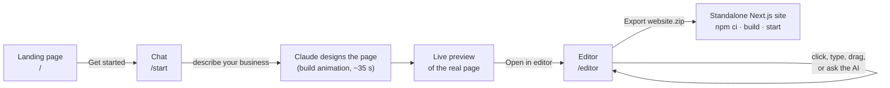

| Address | What you see |
|---|---|
| `/` | The Vyohm Studio product page: what it does, how it works, and a **Get started** button. |
| `/start` | A chat called *Create your landing page*. You describe the business, watch a build animation while Claude works, then see a live preview of your real page. |
| `/editor` | The visual editor. Click anything to edit it, ask the AI for changes, check the phone layout, undo, and export. If you have no page yet, it first asks how you want to start. It never loads a page you didn't ask for. |

The important promises:

- **AI edits change only what you ask.** Claude returns small, targeted changes, not a new page, so your own edits are never thrown away.
- **Phone settings don't touch desktop.** Every element can have phone-only sizes and layout.
- **Everything can be undone,** including AI edits, and the page saves itself in the browser.
- **The export is real code.** A Next.js project with your content, your uploaded images and the same styles you saw in the editor. It needs no API key and no editor code.

---

## 2. Quick start

### What you need

- **Node.js 22** (any version from 20.9 works; see `.nvmrc`) and npm 10
- **A Claude API key** from the Claude Console

### Run it

```bash
git clone https://github.com/Harshraj9142/vyohm-studio.git
cd vyohm-studio
npm ci                          # install exact versions from the lockfile
cp .env.example .env.local      # then open .env.local and paste your key
npm run dev                     # open http://localhost:3000 and click "Get started"
```

### Settings (environment variables)

| Variable | Required | Default | What it does |
|---|---|---|---|
| `ANTHROPIC_API_KEY` | **yes** | – | Your Claude API key. Read only on the server. It is never sent to the browser and never included in exports. |
| `ANTHROPIC_MODEL` | no | `claude-opus-5-5` | The Claude model for generating and editing pages. |
| `ANTHROPIC_EFFORT` | no | `medium` for generation, `low` for edits | How hard Claude thinks (`low`, `medium`, `high`, `xhigh`, `max`). Lower is faster. |

### Scripts

| Command | What it does |
|---|---|
| `npm run dev` | Development server with hot reload on port 3000 |
| `npm run build` then `npm run start` | Production build and server |
| `npm run lint` | ESLint |
| `npm run verify-export -- <path/to/website.zip>` | Checks an exported zip the way the evaluator would: unzip in a clean folder, `npm ci`, `npm run build`, `npm run start`, load the page |
| `npm run test:browser` | All browser test scenarios (see [Testing](#11-testing)) |

### If something goes wrong

| Problem | What to do |
|---|---|
| *"The server has no ANTHROPIC_API_KEY"* | Put the key in `.env.local` (or `.env`) and **restart** `npm run dev`. Env files are read only at start-up. |
| *"The Claude API key was rejected"* | The key is wrong or revoked. Create a new one in the Claude Console. |
| Port 3000 is already in use | `npm run dev -- -p 3001` |
| You changed code or pulled new code, and the page looks old | Stop the dev server and start it again. |
| You want to start completely fresh | In the editor, click **✦ New page**. To delete everything this app saved (page and uploaded images), open DevTools → **Application** → **Storage** → **Clear site data**. |
| Generation seems slow | 25–45 s is normal. The chat shows progress and has a **Cancel** button. After 150 s it stops with a clear message. |

---

## 3. A tour of the app

### 3.1 Landing page (`/`)

The product page explains Vyohm Studio and leads to **Get started**.

| Desktop (top of page) | Phone |
|---|---|
|  | 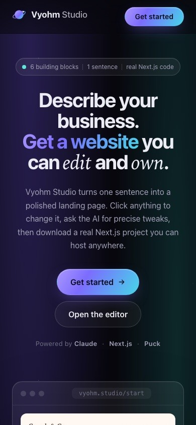 |

What is on it, top to bottom:

1. **Hero:** headline, short pitch, **Get started** button and an animated demo of the product.
2. **Features:** six cards: *From one sentence to a full page*, *Click anything to edit*, *AI edits only what you ask*, *Looks right on phones*, *Undo, autosave, your photos*, *Export real code you own*.
3. **How it works:** three steps, about a minute.
4. **Why trust it:** the careful parts you don't see (validation, safe edits, real export).
5. **Closing call to action** with another **Get started** button.

Full-length screenshots of the whole page: [desktop](docs/screenshots/landing-full.jpg) and [phone](docs/screenshots/landing-mobile.jpg). Animations are switched off for visitors who ask their system for reduced motion.

### 3.2 *Create your landing page* chat (`/start`)

| 1. Describe the business | 2. Claude builds it | 3. Preview of your real page |
|---|---|---|
| 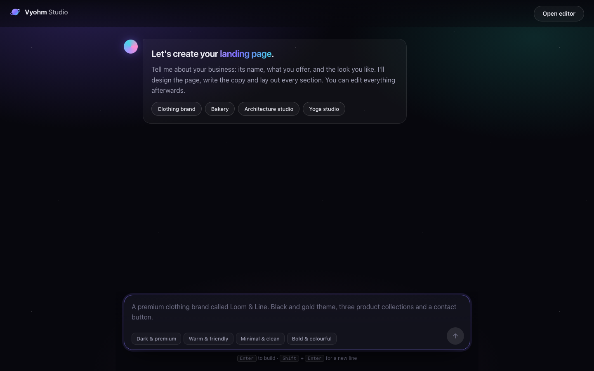 | 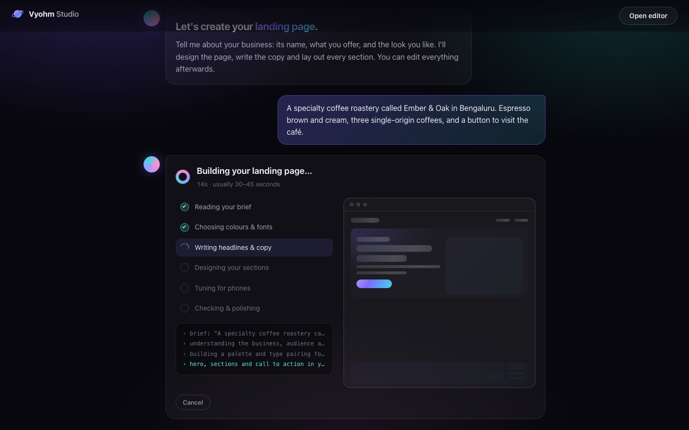 |  |

1. **Describe the business.** Type a sentence or two: the name, what it sells, the style you like, what the page should show. Not sure what to write? Click an example (*Clothing brand*, *Bakery*, *Architecture studio*, *Yoga studio*) and optionally a style (*Dark & premium*, *Warm & friendly*, *Minimal & clean*, *Bold & colourful*). Press **Enter** to build, **Shift + Enter** for a new line.
2. **Claude builds it.** A timeline shows six steps: *Reading your brief → Choosing colours & fonts → Writing headlines & copy → Designing your sections → Tuning for phones → Checking & polishing*, with a timer and a **Cancel** button. Generation is one AI call, so the steps are a visual guide: they move on every 5 seconds, the last one waits for the real answer, and the rest finish quickly when it arrives.
3. **See your real page.** The preview is drawn by the same code as the exported website, and it scrolls slowly so you can see every section. Click **Open in editor** to keep editing, or **Try another idea** to go back with your text still filled in. Even the same brief gives a different design each time (see [design directions](#72-generating-a-page)).

If something fails (no key, Claude busy, a bad answer), the chat shows a plain message and nothing is saved.

### 3.3 Editor welcome screen

If you open `/editor` without a page, you choose how to start:

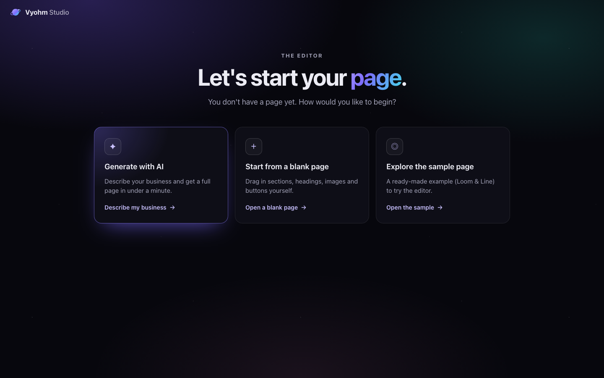

- **Generate with AI:** goes to the chat.
- **Start from a blank page:** an empty page to build with blocks yourself.
- **Explore the sample page:** a ready-made example (*Loom & Line*, a premium clothing brand) to try the editor.

If the browser still holds a page from before that you never chose (for example an old sample that was saved automatically), the screen offers *Continue with this page* instead of opening it without asking. Tip: `/editor?sample=1` opens the sample directly.

### 3.4 The editor at a glance


```text
+-----------------------------------------------------------------------------------------------+
| [1] Header:  Vyohm Studio   Undo  Redo   Saved 15:23   + New page   Export website.zip   Save  |
+--------+--------------------+-------------------------------------------+---------------------+
| [2]    | [3] Panel for the  | [4] Canvas: your page                     | [5] Settings of the |
|  AI    |     chosen tab     |     Phone / Tablet / Desktop, zoom        |     selected element |
| Blocks |                    |     Click anything to select it           |     (or the page)    |
| Outline|                    |                                           |                      |
+--------+--------------------+-------------------------------------------+---------------------+
```

| Area | What it is for |
|---|---|
| **1. Header** | Undo and Redo, the save status (*Saving…* / *Saved 15:23*), **✦ New page** (back to the chat), **Export website.zip** and **Save**. The two icons on the left hide or show the side panels. |
| **2. Left rail** | Three tabs. **AI**: generate a page or edit with AI. **Blocks**: drag new elements onto the page. **Outline**: the page as a tree, to find, select and reorder things. |
| **3. Tab panel** | The content of the chosen tab. |
| **4. Canvas** | Your page, exactly as visitors will see it. Buttons above it switch between **Mobile (390 px)**, **Tablet (820 px)** and **Desktop (1280 px)** and change the zoom. |
| **5. Settings panel** | All settings of the selected element. With nothing selected, it shows the page settings. |

**Keyboard shortcuts**

| Keys | Action |
|---|---|
| ⌘Z / Ctrl+Z | Undo |
| ⇧⌘Z / Ctrl+Shift+Z (or ⌘Y / Ctrl+Y) | Redo |
| Delete / Backspace | Delete the selected element (when you are not typing in a field) |
| ⌘Enter / Ctrl+Enter | Submit in the AI panels (*Generate page*, *Apply with AI*) |
| Enter / Shift+Enter | In the `/start` chat: build / new line |

### 3.5 Editing an element

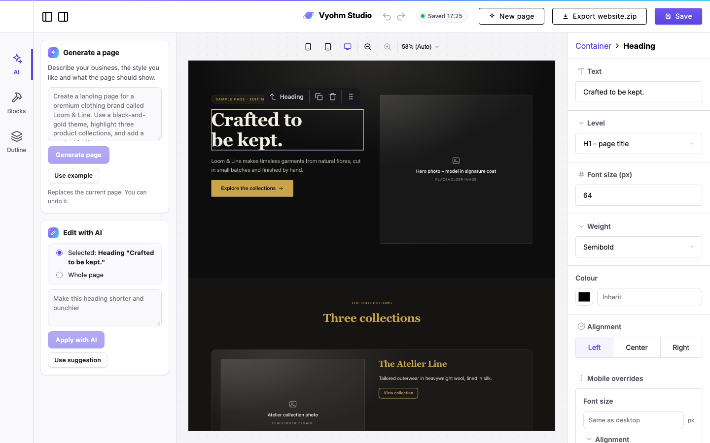

1. **Click** any element on the canvas. A blue frame and a small action bar appear. The bar shows the element type and has **select parent** (↑), **duplicate** and **delete**.
2. **Type directly on the page** to change text in headings, paragraphs and button labels.
3. **Use the settings panel** on the right for everything else. The breadcrumb at the top (*Container › Heading*) shows where the element sits, and clicking a part of it selects that parent.

Colour fields have a colour picker, a hex box and **Clear**. An empty colour means "inherit from the section or page". Number fields stay inside safe ranges.

**Settings for each element type**

| Element | Settings | Phone-only settings |
|---|---|---|
| **Section** (a full-width band of the page) | Anchor name (for links like `#contact`), background colour, text colour, background style (*Solid*, *Soft gradient*, *Spotlight glow*), vertical padding, space between items, content width | Vertical padding, space between items |
| **Container** (one or two columns inside a section) | Columns (one or two), column widths (1:1, 2:1, 1:2), vertical alignment, gap, padding, background, surface (*None*, *Card*, *Glow*, *Outline*), corner radius | Stack or keep side by side, gap, padding |
| **Heading** | Text, level (H1 page title, H2 section title, H3 small title), font size, weight, colour, alignment | Font size, alignment |
| **Paragraph** | Text, style (*Body*, *Lead*, *Eyebrow*, *Badge*), font size, colour, alignment | Font size, alignment |
| **Image** | Upload or replace image, alt text, width (% of column), height (0 = automatic), fit (*Fill* or *Fit*), corner radius, alignment | Width, height |
| **Button** | Label, link (`https://…`, `mailto:…` or `#section`), open in same or new tab, style (*Solid* or *Outline*), icon (*None* or *Arrow →*), background colour, text colour, size (S, M, L), corner radius, alignment | Full width on phones, alignment |
| **Page** (nothing selected) | Page title (browser tab), page description (search engines), heading font, body font, page background, page text colour | – |

**Images.** Select an image and click **Upload image** (or **Replace image**). PNG, JPEG, WebP and GIF up to 8 MB are accepted. The file is stored in your browser, so it survives a reload, and it is copied into the export. Images that Claude generates are labelled placeholders (for example *"Hero photo – model in signature coat"*), because Claude writes text, not photos.

### 3.6 Changing the layout

| A container and its layout settings | The Outline tab |
|---|---|
| 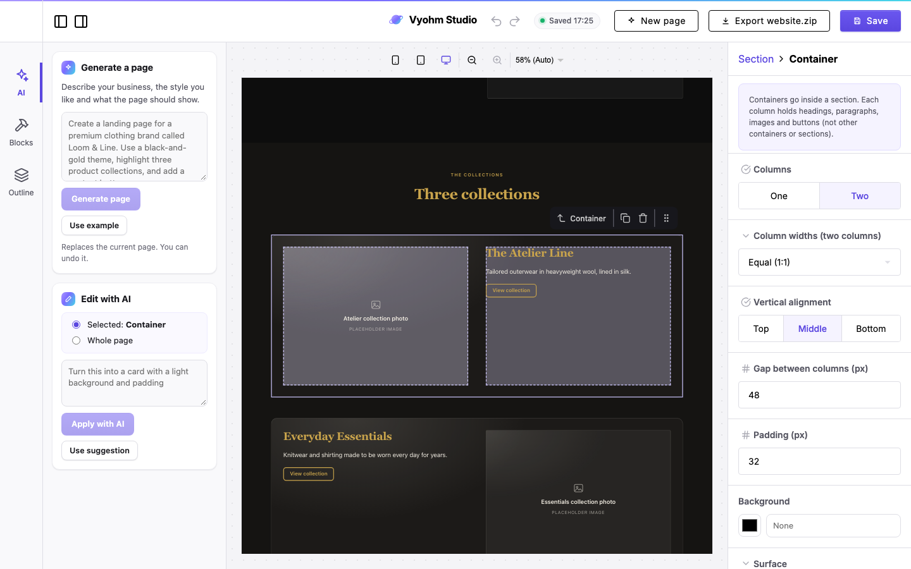 | 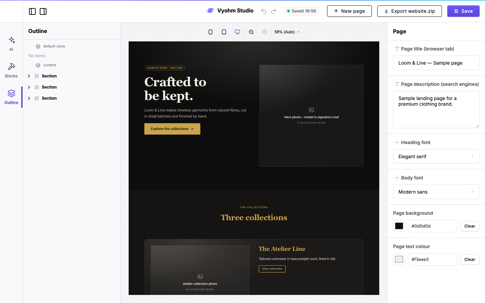 |

- **Add** an element: open **Blocks** and drag it onto the canvas. Blocks are grouped into *Layout* (Section, Container) and *Content* (Heading, Paragraph, Image, Button).
- **Move** an element: drag it to another place, for example from one container column into another, or into a different section.
- **Reorder sections:** drag them on the canvas, or in the **Outline** tab.
- **Duplicate or delete:** use the action bar of the selected element.
- **Container layout:** columns, column widths, vertical alignment, gap, padding, background, surface and corner radius, as shown in the screenshot above.

**What can go where.** These rules keep every page valid, so it always renders and exports correctly:

| Inside… | You can put… |
|---|---|
| the page | Sections only |
| a Section | Container, Heading, Paragraph, Image, Button |
| a Container column | Heading, Paragraph, Image, Button (no sections, no containers inside containers) |

The settings panel of a section or container repeats its rule in a short note.

**Clear feedback while you drag.** If you drag an element over a place where it is not allowed, that area gets a **red dashed outline** and a message explains why. For example: *"Can't drop a Section here: Sections go directly on the page."* After you let go, a message says what really happened: **Not moved**, or **Placed on the page instead** (Puck moves a refused Section to the nearest allowed spot instead of dropping it). Undo takes it back.

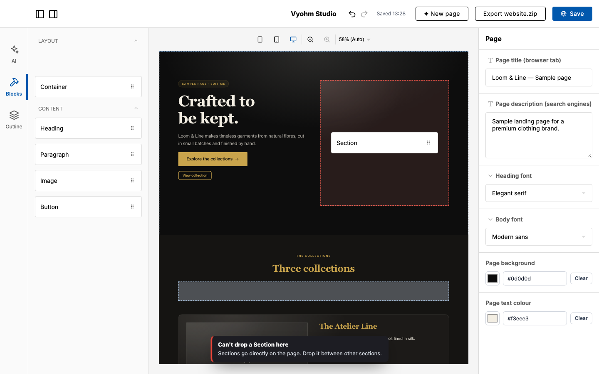

### 3.7 Editing with AI

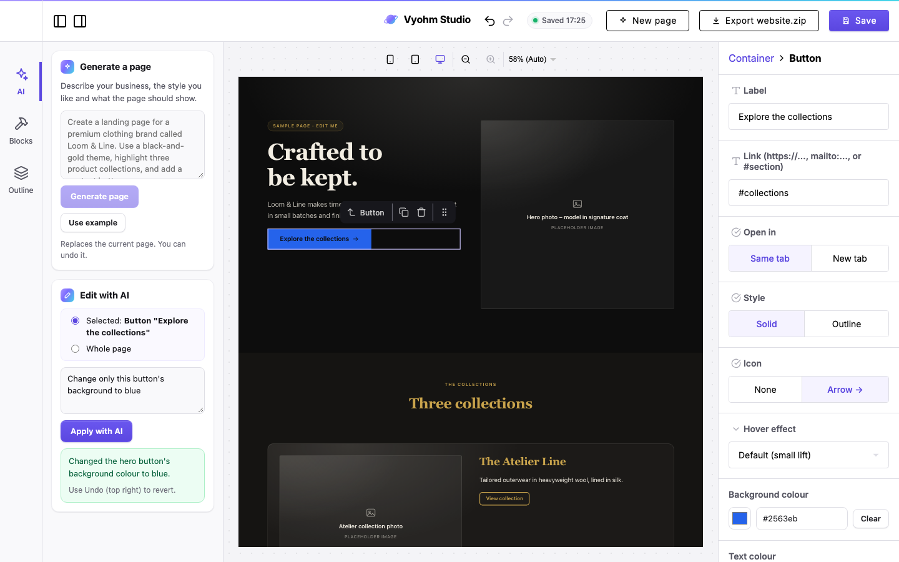

1. **Select** the element you want to change, for example the hero button. The AI tab now says *Selected: Button "Explore the collections"*.
2. Keep **Selected** to change only that element (and what is inside it), or choose **Whole page**.
3. **Type an instruction,** for example *"Change only this button's background to blue"*. **Use suggestion** fills in an example that fits the selected element.
4. Click **Apply with AI** (or press ⌘Enter). Edits take about 3 seconds.
5. A green box says what changed: *"Changed the hero button's background colour to blue. Use Undo (top right) to revert."* The element stays selected, and its settings panel shows the new value (`#2563eb`).

What the AI can do: change any setting or text, add, delete or move elements, and change page settings (fonts, colours, title).

What keeps your work safe:

- **Only the target changes.** With *Selected*, the server rejects any change outside that element. In the test for this exact edit, after many manual edits, exactly one value on the whole page changed: the button's background colour.
- **Your manual edits are kept.** Claude's changes are applied to the page as it is *now*, not to an old copy.
- **No silent overwrites.** If you edit the same element while the AI is still working, you are asked: *Apply anyway* or *Discard*.
- **A bad answer changes nothing.** Invalid AI answers are rejected and the page stays as it was, with a clear message.
- **One Undo reverses the whole AI edit.**

The **Generate a page** box at the top of the AI tab creates a whole new page from a description, like the chat. It replaces the current page, and Undo brings the old one back.

### 3.8 Phone layout (mobile overrides)

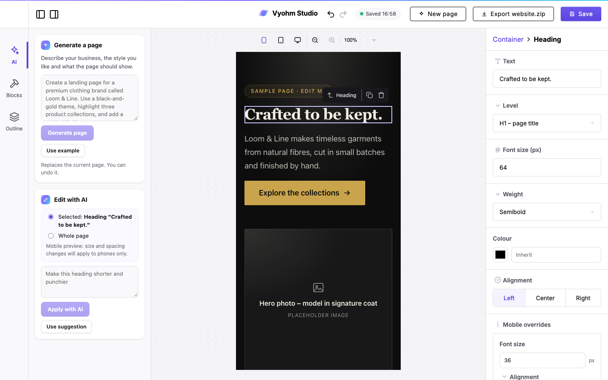

1. Click the **phone icon** above the canvas. The preview becomes 390 px wide.
2. Select an element and open **Mobile overrides** in its settings.
3. Set a phone-only value, for example a heading font size of 36 px. The desktop value doesn't change.

An empty override means "same as desktop". By default, two-column containers stack into one column on phones, and text and images shrink to fit, so pages never scroll sideways. Phone settings apply below 768 px wide, in the editor and in the exported site.

### 3.9 Undo, saving and images

- **Undo and Redo** (header buttons, ⌘Z, ⇧⌘Z) cover everything: text, styles, layout, mobile overrides, uploads and AI edits. Each AI edit is one step.
- **Autosave:** the page is saved in your browser (IndexedDB) less than a second after each change. The header shows *Saving…* and then *Saved 15:23*. **Save** saves right away.
- **Reload-safe:** reloading the editor brings back the page and the uploaded images.
- **Where it lives:** in this browser profile only. Another browser, a private window or *Clear site data* won't have it (see [Limitations](#12-limitations)).

### 3.10 Exporting the website

Click **Export website.zip**. The zip is built in your browser and contains a complete Next.js project:

```text
website/
├── package.json, package-lock.json   only next, react and react-dom (exact versions, 30 packages in total)
├── next.config.ts, tsconfig.json, .nvmrc, .gitignore
├── README.md                         how to run it
├── app/layout.tsx, app/page.tsx, app/globals.css
├── components/site/                  the SAME blocks and CSS the editor uses
├── data/page.json                    your page content
└── public/assets/                    your uploaded images
```

Run it:

```bash
unzip website.zip -d website && cd website
npm ci
npm run build
npm run start        # http://localhost:3000
```

Or check it in one command, exactly like the evaluator: `npm run verify-export -- ~/Downloads/website.zip`.

| Exported site on desktop | On a phone |
|---|---|
| 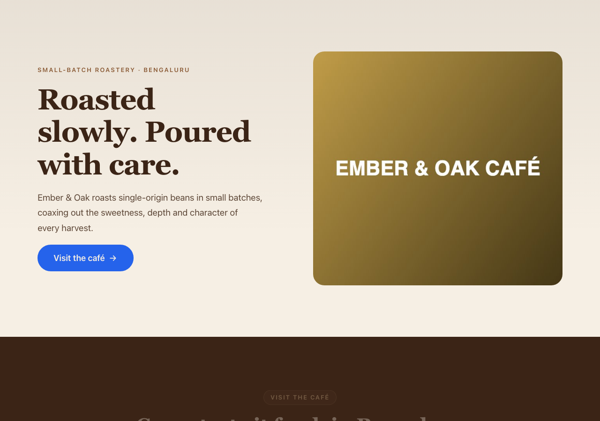 | 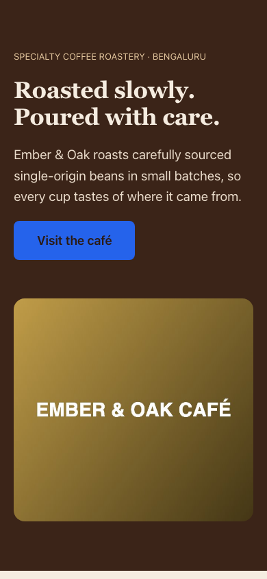 |

What the export guarantees:

- **Same look as the editor.** It renders with the same block components and the same `site.css`.
- **Portable images.** Uploaded images (`asset:<id>` in the page data) are written to `public/assets/` and the links are rewritten to `/assets/<id>.<ext>`.
- **No secrets and no editor code.** No API key, no Puck, no Claude SDK.
- **Clean install.** The lockfile is committed and tested, so `npm ci` works the same everywhere. The exported site also adds scroll fade-ins and card hover effects (off for reduced motion).

Proof: [export-verify.log](evidence/export-verify.log), [exported-site.log](evidence/exported-site.log) and the final [website.zip](evidence/website.zip). A full-page screenshot of an exported site is in [Design system](#8-design-system-for-generated-sites).

---

## 4. 8-minute demo script

| Time | Step | What to show |
|---|---|---|
| 0:00 | **Generate** | On `/`, click **Get started**. Pick the *Clothing brand* example (or type a brief) and press **Enter**. Point out the build steps and the timer. After ~35 s the real page previews. Click **Open in editor**. |
| 1:30 | **Edit text** | Click the h1 and type on the canvas. Change its size and weight in the settings panel. |
| 2:15 | **Replace an image** | Select the hero image → **Upload image**. Change the height and the radius. |
| 3:00 | **Change the layout** | Drag a button into the other column. Reorder two sections in **Outline**. Duplicate a card. Drag a Section over a container column to show the red refusal. |
| 4:15 | **AI edit** | Select a button → *"Change only this button's background to blue"* → **Apply with AI** (~3 s). Point out that nothing else changed. Try a **Whole page** edit, e.g. *"Make all corners more rounded"*. |
| 5:30 | **Mobile** | Phone view → set a heading's phone font size. Switch back to desktop: unchanged. |
| 6:15 | **Undo, save, reload** | Undo the AI edit, Redo it. Reload the page: everything, including the uploaded image, is still there. |
| 7:00 | **Export** | **Export website.zip** → run `npm run verify-export -- ~/Downloads/website.zip`, or open the unzipped project with `npm ci && npm run build && npm run start`. |

---

## 5. Feature status

**Working** = checked by an automated test or a recorded real run (see [docs/TESTING.md](docs/TESTING.md)). **Partial** = works, with a stated gap.

| Requirement | Status | Evidence / notes |
|---|---|---|
| **AI generation** from a fresh prompt via a real model call: relevant copy, requested theme, multi-section page | Working | Seven briefs generated with the real model (clothing, bakery, yoga, architecture, coffee ×2, bicycle shop), 20–42 s each. Each run follows the requested colours and item counts. [full-flow.log](evidence/full-flow.log), [TESTING.md](docs/TESTING.md#ai-generation-runs-real-model-claude-opus-5-5-effort-medium) |
| Varied designs for the same kind of brief | Working | Claude proposes four design directions and builds the one the server picks at random ([7.2](#72-generating-a-page)). 8 real runs in [design-variety.log](evidence/design-variety.log): [same brief three times](docs/screenshots/design-variety-same-brief.png), [four different briefs](docs/screenshots/design-variety-briefs.png). |
| Generation loading and failure states | Working | Build steps, timer and Cancel. Malformed answers and API errors are rejected and the page is unchanged (`ai-failures`, server error cases in TESTING.md). |
| Six element types; container with 1 or 2 columns and nested elements | Working | [blocks.tsx](components/site/blocks.tsx), [puck-config.tsx](components/editor/puck-config.tsx) |
| Select and edit properties; direct canvas text editing | Working | `layout-and-inline` (typing on the canvas), `demo-sequence` (settings panel) |
| Button label, link and style; image upload/replace, size, fit, alt | Working | Fields in [puck-config.tsx](components/editor/puck-config.tsx); upload tested in `upload-persist` and `demo-sequence` |
| Add, duplicate, delete | Working | `layout-and-inline` (action bar duplicate/delete; insert) |
| Move between containers, reorder sections | Working | `drag-and-drop`: a **real mouse drag** (Chrome input events) moves a button into another container. Section reorder is tested with Puck's `reorder` action. |
| Container padding, gap, alignment, columns | Working (not separately automated) | Fields plus the responsive grid in [site.css](components/site/site.css) |
| Restrict invalid nesting with clear feedback | Working | Red dashed outline and an explanation while dragging; an honest message after the drop. Rules come from `NESTING` ([drag-feedback.tsx](components/editor/drag-feedback.tsx)); AI edits are checked in code. `drag-and-drop` (11 checks, real mouse), `ai-failures` #8, [screenshot](docs/screenshots/drag-refused.png) |
| **AI revisions** of a selected element or the whole page, preserving unrelated content | Working | `demo-sequence`: after manual edits, exactly one value changed on the whole page (the button's `bgColor`). `real-ai-edits`: a whole-page change touched only `radius` values. |
| Failed or invalid AI response leaves the page intact | Working | `ai-failures` #1, #5–#8 |
| Concurrency: manual edit while AI is pending | Working | `ai-failures` #2 and #4: conflict prompt, nothing overwritten silently |
| Desktop/mobile preview; mobile override without changing desktop; stacking; no overflow | Working | `mobile-override`, [exported-site.log](evidence/exported-site.log) |
| Undo/redo of content, style, layout and AI edits | Working | `demo-sequence`, `ai-failures` #3, `mobile-override` |
| Save and reload restores page and uploaded images | Working | `upload-persist` + `after-reload` (same browser profile) |
| Editor never shows a page the user didn't choose | Working | `editor-welcome`, `editor-sample-choice`, `legacy-sample-*` (an old auto-saved sample gets the welcome screen) |
| Product landing page and guided *Get started* chat with build animation and live preview | Working | `landing` (desktop + phone), `start-flow` (chat → animation → preview → editor), one real chat run (25 s); reduced-motion fallback checked |
| **Next.js export**: independent, portable assets, clean `npm ci` / `build` / `start` | Working | [export-verify.log](evidence/export-verify.log), [exported-site.log](evidence/exported-site.log), [website.zip](evidence/website.zip) |
| Design system: card surfaces, label styles, section backgrounds, arrow buttons, scroll fade-in | Working | `design-options` (settings panel → preview, undo, no live effects in the editor); generated pages use the options ([exported-site.log](evidence/exported-site.log)) |
| Basic accessibility | Partial | Alt-text field, heading levels, focus outlines, keyboard-reachable controls, labelled inputs, reduced motion. No full audit and no automatic contrast check (see [Limitations](#12-limitations)). |

---

## 6. How it works

### 6.1 Architecture

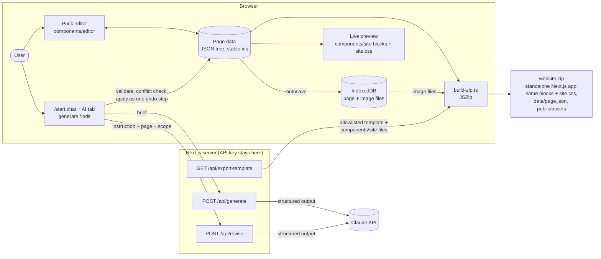

In words:

- The **browser** holds the page as one JSON tree. The editor, the AI features, the preview and the export all read and write this same tree.
- The **server** has three small routes. Two talk to Claude (the API key never leaves the server). The third serves the files the export needs, from a fixed allowlist.
- **`components/site/`** is shared. It has no editor code, so the editor preview and the exported website draw the page with exactly the same components and CSS.

### 6.2 The page model

There is one source of truth: Puck's `Data` JSON, typed in [model.ts](components/site/model.ts).

```text
root.props            title, description, fonts, page colours
root.props.content    [Section, Section, ...]                     <- slot: Sections only
  Section.props       anchor, colours, bgStyle, paddingY, gap, maxWidth, mobile{...}
  Section.content     [Container | Heading | Paragraph | Image | Button]
  Container.props     columns, ratio, gap, padding, valign, bgColor, surface, radius, mobile{...}
  Container.left/right  [Heading | Paragraph | Image | Button]
```

- Every element is `{ type, props: { id, ...settings } }`. The `id` (for example `Button-7369316172c5`) never changes. AI edits use it to target exactly one element.
- **Phone overrides** live in `props.mobile` (for example `{ fontSize: 30 }`). Blocks write settings as CSS variables (`--h-size`, `--h-size-m`), and [site.css](components/site/site.css) uses the `-m` value below 768 px. Empty means "same as desktop".
- **Images:** uploads are files in IndexedDB. The page only holds `asset:<id>`. AI images are `placeholder:<description>`. The export rewrites `asset:<id>` to `/assets/<id>.<ext>`.
- **Allowed values** (number ranges, option lists, nesting) are defined once (`LIMITS`, `CHOICES`, `NESTING` in model.ts). The editor fields, the AI clean-up and the validator ([page-schema.ts](lib/page-schema.ts)) all use the same definitions, so they can't disagree.
- **Optional style settings** (`Section.bgStyle`, `Container.surface`, `Paragraph.variant`, `Button.icon`) were added later. Pages saved without them still load and validate.

### 6.3 What happens on an AI edit: "Change only this button's background to blue"

1. [ai-edit-panel.tsx](components/editor/ai-edit-panel.tsx) copies the current page (`before`), records the scope `{ kind: "element", id: "Button-…" }`, and sends `{ instruction, scope, page, viewport }` to `/api/revise`.
2. [revise.ts](lib/ai/revise.ts) calls Claude with a [structured-output schema](lib/ai/revise-schema.ts), so the reply is always JSON of the form `{ summary, operations: [...] }`. Here Claude replied with one operation: `{ op: "update", id: "Button-…", changes: [{ prop: "bgColor", value: "#2563eb" }] }`.
3. The server test-applies the operations with [apply.ts](lib/revise/apply.ts). It checks which settings each type allows, cleans values (hex colours only, safe links, numbers clamped to range), stays inside the selection, follows the nesting rules, and runs the full page validator. If anything fails, Claude gets one retry with the exact error. If that fails too, the request fails and nothing changes.
4. Back in the browser, `findConflicts` compares `before` with the current page for the elements the operations touch. If you edited that button in the meantime, you are asked (*Apply anyway / Discard*) instead of being overwritten silently.
5. The operations are applied to the **current** page, not to `before`, so edits made elsewhere during the request are kept. The result is validated again and dispatched as `setData` with `recordHistory: true` (one undo step). The same button stays selected.
6. Autosave writes the page to IndexedDB. The preview re-draws the button with the same `Button` component the export uses.

**A manual edit is simpler:** a settings change or typing on the canvas triggers a Puck action (`replace`, `move`, …). Puck updates the same JSON and records history, `onChange` schedules the autosave, and the preview re-draws.

### 6.4 What Puck provides and what I built

**Pre-existing code (disclosure):** the repository started from the official `create-next-app` starter (first commit `676d4bd`). Puck (MIT) is used as a library, and design ideas came from 21st.dev (see [Design system](#8-design-system-for-generated-sites)). Everything in the right-hand column was written for this project, with AI assistance recorded in [docs/AI_USE.md](docs/AI_USE.md).

| Puck (library) | Built for this project |
|---|---|
| Editor shell, selection, drag and drop, slots, inline text fields, viewport switcher, undo/redo history, outline | The six blocks and their responsive CSS; field configuration; colour, image-upload and optional-number fields; nesting rules, notes and drag feedback |
| | Landing page, *Get started* chat, build animation and live preview; editor welcome screen |
| | AI generation and edit endpoints, prompts, design directions, structured-output schemas, clean-up, validation, operation applier, scope and conflict checks, AI tab UI |
| | IndexedDB storage for the page and images; autosave |
| | Export: standalone renderer, project template with a pinned lockfile, asset rewriting, ZIP; verification script |
| | Headless-Chrome test runner and scenarios |

---

## 7. AI integration in detail

### 7.1 Settings

| | Generate a page | Edit with AI |
|---|---|---|
| Route | `POST /api/generate` `{ prompt }` | `POST /api/revise` `{ instruction, scope, page, viewport }` |
| Model | `claude-opus-5-5` (`ANTHROPIC_MODEL`) | same |
| Effort | `medium` (`ANTHROPIC_EFFORT`) | `low` |
| Output | Structured output: [generate-schema.ts](lib/ai/generate-schema.ts) | Structured output: [revise-schema.ts](lib/ai/revise-schema.ts) |
| Typical time | 25–45 s | ~3 s |
| Time limit | 150 s, no automatic retry (the UI offers *Try again*) | 60 s, one automatic retry |
| If the answer is invalid | Rejected with a clear message | One retry with the exact error, then rejected |
| Input limits | Brief 10–3,000 characters | Instruction 2–1,000 characters; the current page must pass the validator before it is sent |

- **Structured outputs** (`client.beta.messages.parse` with a Zod schema) make Claude's answer always parseable JSON in the exact shape we need. The API doesn't accept `min`/`max` on numbers, so ranges are written in the field descriptions and enforced afterwards by clamping.
- **Server-side fallback** (`fallbacks: "default"`): if Claude's safety filter declines a request, the API can retry it on another model automatically.
- **The API key stays on the server.** The browser only talks to our own routes.

### 7.2 Generating a page

```text
brief ──> server picks a direction number (1–4) at random, never the same as last time
      ──> Claude writes, in this order:
            1. designDirections   4 clearly different looks for THIS brief, one per line,
                                  each with a different hero layout
            2. sectionPlan        the chosen direction's sections, one per line: "purpose: pattern"
            3. the page           title, fonts, colours, 4–7 sections
      ──> convert.ts   adds ids and defaults, clamps numbers, cleans colours, text and links
      ──> page-schema.ts   strict validation (shape, nesting, ranges, unique ids and anchors)
      ──> preview / editor
```

**Why design directions?** Asked for "a landing page", a model tends to produce the same safe layout every time. Here Claude first writes four different directions, one line each. One line from a real run for a bicycle repair shop:

```text
Garden Workshop | friendly, sunny neighbourhood feel; rounded type, soft cards, cream page with deep green bands | background #F6F1E3, accent #2F6B3A | rounded | split-image-left
```

The server, not Claude, picks which direction to build. The number is random and never the same as the previous generation, so Claude can't always fall back to the safest idea, and **Try another idea** always gives a different direction. JSON is written in order, so the directions and the section plan work as a "think first" step before the sections.

**The same brief, three generations** (the Loom & Line clothing brief: black and gold, three collections). Each one has a different hero, layout pattern and use of gold:

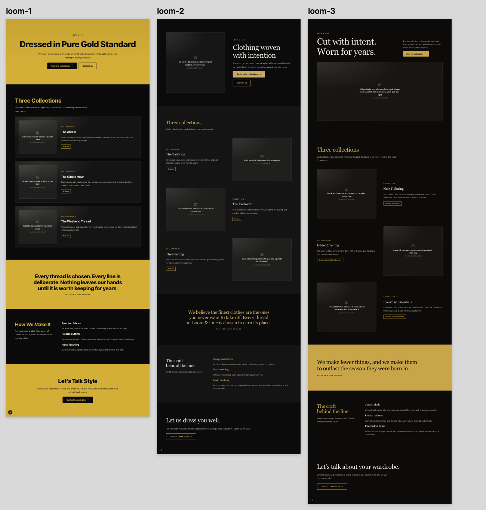

**Different businesses** (clothing, bakery, fintech app, gym). Each page has its own colours, fonts, hero layout and section patterns:

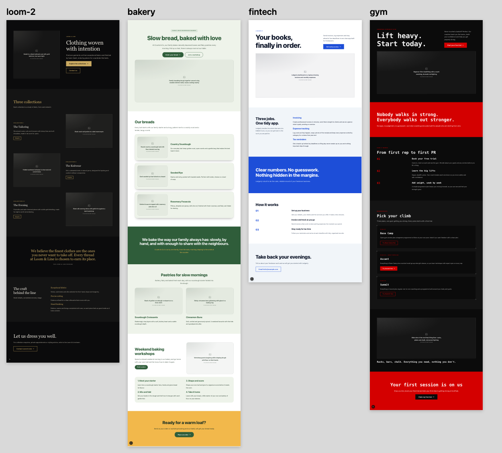

These come from 8 real generations recorded in [evidence/design-variety.log](evidence/design-variety.log) (30–45 s each, all fine at phone width). The first round found a problem: the random number came out 4 in four of five runs, and direction 4 used the same hero layout each time, so two pages for the same brief looked alike. That led to the two rules above: the number never repeats, and the four directions must use four different hero layouts.

- **Hero layouts** (each direction names one): `split-image-right`, `split-image-left`, `centered-no-image`, `centered-image-below`, `asymmetric-big-type`.
- **Section patterns** (at least 3 different ones per page, never the same twice in a row): alternating rows, card grid, two-up, statement, feature list, image band, steps, contact.
- **The prompt also lists habits to avoid** unless a direction calls for them: the hero image always on the right, a label above every heading, everything centred, an arrow on every button, and stock colour schemes when the brief names none.
- **The brief always wins:** if it names colours or a mood, every direction keeps them and only varies how they are used.

Every page also follows fixed rules: exactly one h1 in the hero, exactly the number of items the brief asks for, a closing section with the anchor `contact`, unique anchors, and no invented facts (no real addresses, prices, reviews or statistics; placeholders are labelled). The full prompt is in [prompts.ts](lib/ai/prompts.ts).

### 7.3 Editing with AI: operations, not a new page

Claude never returns a whole page for an edit. It returns a list of operations:

| Operation | Example |
|---|---|
| `update` | Set `bgColor` of `Button-…` to `#2563eb` |
| `updatePage` | Change the page's heading font to `serif` |
| `insert` | Add a new Paragraph into `Container-…` (left column) at position 2 |
| `move` | Move `Image-…` into another column or section |
| `delete` | Remove `Button-…` |

[apply.ts](lib/revise/apply.ts) applies them one by one and refuses anything unsafe: a setting that type doesn't have, a change outside the selected element, a forbidden nesting, an unknown id. The new element in `insert` is sent as a JSON string and checked by the same converters as generation (see [debugging example 2](#10-debugging-examples)).

### 7.4 Safety checks on every AI answer

| Check | Where |
|---|---|
| Text: control characters removed, length limited. React always shows it as plain text, so any HTML in it is never run. | `cleanText` in [convert.ts](lib/ai/convert.ts) |
| Colours: only `#rgb` / `#rrggbb` hex values | `safeColor` in [style.ts](components/site/style.ts) |
| Links: only `https://`, `http://`, `mailto:`, `tel:`, `#section` or `/path`; anything else (like `javascript:`) becomes `#` | `safeHref` in [style.ts](components/site/style.ts) |
| Numbers clamped to the ranges in `LIMITS` | [convert.ts](lib/ai/convert.ts), [apply.ts](lib/revise/apply.ts) |
| Page shape, nesting, unique ids and anchors | [page-schema.ts](lib/page-schema.ts) (on the server and again in the browser) |

**Error messages people see** (from [claude.ts](lib/ai/claude.ts)): missing API key, key rejected, no access to the model, *"Claude is busy (rate limit)"*, *"Claude took too long to answer"*, *"Could not reach the Claude API"*, refusals, and answers that were cut off or failed validation. Details go to the server log. Every failure leaves the page unchanged.

---

## 8. Design system for generated sites

Generated pages share a small design system. The ideas came from the **21st.dev** component catalog (searched through its MCP server). They are rewritten as plain CSS in [site.css](components/site/site.css), so the export still needs no extra libraries.

| Setting | Options | Inspired by |
|---|---|---|
| Container `surface` | `card` (soft shadow, lifts on hover), `glow` (light from the top corner), `outline` (hairline border with "+" corner marks) | 21st.dev *Feature Grid Spotlight Cards* (Hirael, MIT) |
| Paragraph `variant` | `lead` (muted intro), `eyebrow` (small caps label), `badge` (pill label) | the same component's section-header badge |
| Section `bgStyle` | `spotlight` (glow at the top), `gradient` (soft wash) | the same component's top glow |
| Button `icon` | `arrow` (→ that nudges on hover) | 21st.dev *CTA Section* (shadcndesign) |

All tints use `color-mix()` with `currentColor`, so they work with any brand colour and on dark or light pages. On the exported site, items fade up as they scroll into view (CSS scroll-driven animation) and cards lift on hover. Both are off inside the editor and for visitors who prefer reduced motion. The generation prompt explains each option so Claude uses them where they fit the chosen direction, not everywhere.

<p align="center">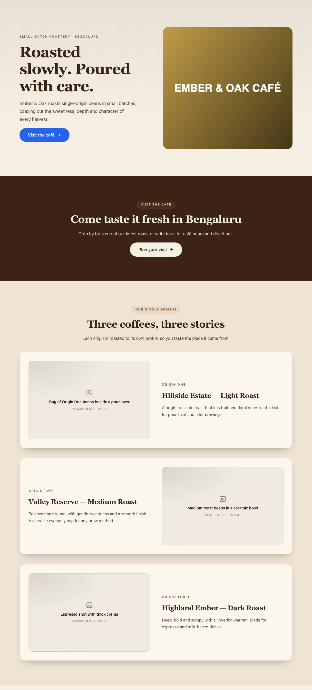</p>

*An exported page (Ember & Oak, a coffee roastery): eyebrow label and lead text in the hero, arrow buttons, a brand-colour band with a badge, and three `card` surfaces. [See the full page](docs/screenshots/exported-full-page.png).*

---

## 9. Decisions and tradeoffs

**Editor: Puck.** It is the challenge's recommended foundation, it is React, and it already has slots for nesting, inline editing, viewports and history. Alternatives I considered:
- **GrapesJS:** based on HTML/CSS strings, which makes the data harder to validate and to export as React.
- **Craft.js:** a similar idea, but needs more custom UI.
- **Writing my own editor:** not realistic in 6 hours.

**Tradeoff 1: AI edits are operations, not a regenerated page.** Asking Claude for a whole new page is simpler, but any manual edit Claude doesn't copy exactly would be lost. Operations (`update` / `insert` / `delete` / `move` / `updatePage`) applied to the current page make that impossible by design, and they can be scope-checked and conflict-checked. The costs: a schema and an applier to maintain, and wide changes such as "rewrite all copy" produce many operations.

**Tradeoff 2: Browser storage instead of a server database.** IndexedDB holds the page and real image files with no backend or account, and survives reloads, which is enough for a prototype. The costs: the data stays in one browser profile, there is one page per browser, no sharing, and it is lost if site data is cleared. I chose IndexedDB over localStorage because localStorage holds only ~5 MB of text, and one photo can be bigger than that.

**Tradeoff 3: The export uses its own ~60-line renderer instead of Puck's `<Render>`.** The export then needs only `next`, `react` and `react-dom` (30 packages, `npm ci` in about 4 s) and contains no editor code. The two stay identical because both use the same [blocks.tsx](components/site/blocks.tsx) and [site.css](components/site/site.css). The cost: the renderer must copy Puck's slot wrapper markup.

**Tradeoff 4: Random design direction instead of letting Claude choose.** Letting Claude pick its favourite direction gives the same safe page again and again. Picking at random (never the same number twice in a row) guarantees variety, and "Try another idea" really gives something new. The costs: a direction can fit a brief a little less well (the brief's colours and mood are always kept), each answer is a few lines longer, and the extra fields bring the schema to the API's size limit.

Other choices:
- **Structured outputs + Zod everywhere.** The model's output is always parseable, and everything is validated again before it touches the editor (on the server and in the browser).
- **One fixed export template with a committed lockfile.** Dependencies don't change per page, so the lockfile is generated and tested once.
- **CSS variables for responsive styles.** Per-element phone overrides without generating a stylesheet. The variable names are per type, so values don't leak into children.
- **Model `claude-opus-5-5`,** with `medium` effort for generation (quality) and `low` for edits (~3 s). Both can be changed with env vars.
- **Landing page and chat as CSS Modules with system fonts.** Puck copies the host page's styles into its preview iframe, so global CSS would change how sites look in the editor. CSS Modules keep the marketing styles scoped. System fonts (instead of Google Fonts) let the builder build without internet.
- **Design references from 21st.dev, rewritten as my own CSS.** 21st.dev components use Tailwind and shadcn and sometimes need JavaScript (for example a spotlight that follows the pointer). Copying them would add Tailwind to every export and break the "3 dependencies" property, so I took the visual ideas and rebuilt them as four optional settings in plain CSS. I dropped the pointer-following spotlight because it needs client-side JavaScript.

---

## 10. Debugging examples

**1. AI changes were not undoable.** After a generated page was applied, Undo did nothing. I read Puck's reducer and found that `setData`, `setUi` and `set` are left out of history unless the action passes `recordHistory: true`, and history entries are debounced by 250 ms. The fix is `dispatch({ type: "setData", data, recordHistory: true })`, checked by the Undo/Redo steps in `ai-failures` #3 and `demo-sequence`.

**2. "The compiled grammar is too large" (twice).** My first edit schema embedded every element's full schema inside the `insert` operation, and the structured-output API rejected it with a 400. The fix: `insert` carries the new element as a JSON string, which [convert.ts](lib/ai/convert.ts) (`parseInsertedElement`) parses and the converters clean. Invalid elements go back to Claude once as an error. Checked with a direct API call (one operation in 3.4 s) and the browser tests. The same limit came back with design directions. The first version described each direction as an object with a hero-layout enum, and every generation failed with HTTP 502. Now both planning fields (`designDirections` and `sectionPlan`) are single plain strings, and the hero layouts are listed in the prompt instead of the schema. Lesson: the generation schema sits close to the API's size limit, so every new field must be tested with a real request.

**3. A flaky test that wasn't flaky.** The `ai-failures` scenario failed only inside my test loop. I replaced crashes with recorded diagnostics, which showed the fake AI response had no page fixture. The cause: zsh doesn't word-split `$extra`, so `--fixture <file>` reached the runner as a single argument. I moved the suite into a bash script ([run-all.sh](tests/browser/run-all.sh)).

**4. Animations that disappeared for accessibility users.** A full-page screenshot with *reduced motion* showed the landing page's hero demo as empty boxes. My reduced-motion rule made animations finish instantly, and these looping animations end on a faded-out frame. The fix: switch animations off (`animation: none`) for those users, so every element shows in its normal, visible state. Checked by re-taking the reduced-motion screenshot ([landing-full.jpg](docs/screenshots/landing-full.jpg)).

**5. Puck doesn't always refuse an invalid drop.** My first nesting message said *"Not moved"* after a refused drop. A real-mouse test showed the page actually gained a section: when a Section is dropped on a container column, Puck places it at the nearest allowed spot (the page) instead of refusing. The message now compares the page before and after the drop and reports what really happened. Checked in `drag-and-drop`, which also confirms that Undo takes the section back.

---

## 11. Testing

The browser tests drive a real headless Chrome through the DevTools protocol ([cdp.mjs](tests/browser/cdp.mjs)), including **real mouse drags**. They run against a production build with a test hook switched on.

```bash
NEXT_PUBLIC_TEST_HOOKS=1 npm run build && npx next start -p 3211   # terminal 1
npm run test:browser                                                # terminal 2
```

Latest full run: **77 passed, 0 failed** ([evidence/browser-tests.log](evidence/browser-tests.log)).

| Scenario | What it checks |
|---|---|
| `landing` (desktop + phone) | Landing page renders, links work, no sideways scroll |
| `start-flow` | Chat → build animation → preview → editor |
| `editor-welcome`, `editor-sample-choice`, `legacy-sample-*` | No page is shown without the user choosing one |
| `layout-and-inline` | Typing on the canvas, insert, duplicate, delete |
| `drag-and-drop` | Real mouse drags, red refusal outline, after-drop messages, Undo |
| `design-options` | Surfaces, label styles, backgrounds and icons from the settings panel |
| `mobile-override` | Phone value changes, desktop value stays |
| `ai-failures` | Bad AI answers, API errors, conflicts and Undo; the page is never damaged |
| `upload-persist`, `after-reload` | Uploaded image and page survive a reload |
| `demo-sequence`, `real-ai-edits` | The demo path with **real** Claude edits; exactly the asked-for values change |
| `full-flow-export`, `exported-site` | Export → `npm ci` → build → start → the site renders on desktop and phone |

Real AI generation runs (times and results) and the "not tested" list are in [docs/TESTING.md](docs/TESTING.md).

---

## 12. Limitations

- **Browser storage:** the page and images live in this browser profile's IndexedDB only. Another browser or device won't see them; private windows and *Clear site data* lose them; storage limits vary by browser. If IndexedDB is unavailable, the editor still works but shows a "not saving" warning (that path is untested). There is one page per browser, and two open tabs overwrite each other (the last save wins).
- **Images:** AI can't create real photos, only labelled placeholders. Images added as `https://` links stay remote in the export; only uploads are bundled. The upload limit is 8 MB, with no resizing.
- **"Only" means only:** an AI edit like "only the background" won't fix contrast it breaks. In the example above, the blue button keeps its dark text. There is no automatic contrast check.
- **Fonts** are system font stacks (no web fonts), so they look slightly different on each OS.
- **Generation takes about 25–45 s,** with no streaming.
- **The generation schema is at the API's size limit.** Adding another field (for example a 3-column option) can make every generation fail with *"compiled grammar is too large"*, so any new field must be tested with a real request first ([TESTING.md](docs/TESTING.md)).
- **Design directions are random:** you can't yet choose between the four directions Claude proposed.
- **AI time limits:** generation stops after 150 s and edits after 60 s, with a clear *"Claude took too long"* message. During testing one edit once took 6 minutes to come back from the API; without limits the user would just wait.
- **Drag and drop** works with a mouse; touch dragging on tablets was not tested.
- **No contact-form backend:** buttons are links to sections or `mailto:`.
- A test hook (`window.__vsPuck`) is active only in development or in builds with `NEXT_PUBLIC_TEST_HOOKS=1`.

## 13. Next improvements

1. Warn about low contrast after any colour change (manual or AI) and offer an AI fix.
2. Server-side storage (a database plus file storage) with page versions and sharing.
3. Stream generation and draw sections as they arrive, to shorten the felt wait.
4. Unit tests for `apply.ts` and the converters, alongside the browser scenarios.
5. A keyboard alternative to drag and drop ("move up / move down / move to…") for people who can't use a mouse.
6. Let the user pick between the four design directions instead of a random one.

---

## 14. Project structure

```text
app/
  page.tsx                  landing page (/)
  start/page.tsx            "Create your landing page" chat (/start)
  editor/page.tsx           the editor (/editor)
  api/generate/route.ts     POST: brief -> validated page
  api/revise/route.ts       POST: instruction + page + scope -> operations
  api/export-template/      GET: allowlisted template + shared component files
components/
  site/                     shared by the editor preview AND the export (no editor code)
    model.ts                page model types, defaults, LIMITS, CHOICES, NESTING
    blocks.tsx              the six blocks
    site.css                responsive styles and design system (CSS variables, 767px breakpoint)
    render.tsx              standalone renderer used by the export and the chat preview
  editor/                   Puck config, custom fields, AI tab, drag feedback, welcome screen, export button, autosave
  marketing/                landing page and brand theme (CSS Modules, so nothing leaks into the editor)
  start/                    chat, build animation, live page preview
lib/
  ai/                       Claude client, prompts, schemas, convert, generate, revise
  revise/apply.ts           applies AI operations safely (scope, nesting, conflicts)
  page-schema.ts            strict page validator
  storage.ts                IndexedDB page and image storage
  export/build-zip.ts       builds website.zip in the browser
export-template/            Next.js project template (pinned versions + lockfile)
scripts/verify-export.sh    checks a website.zip like the evaluator
tests/browser/              headless-Chrome runner, scenarios, fixture
evidence/                   test logs + the final website.zip
docs/                       TESTING.md, AI_USE.md, screenshots
```

**How AI was used to build this project:** see [docs/AI_USE.md](docs/AI_USE.md).
